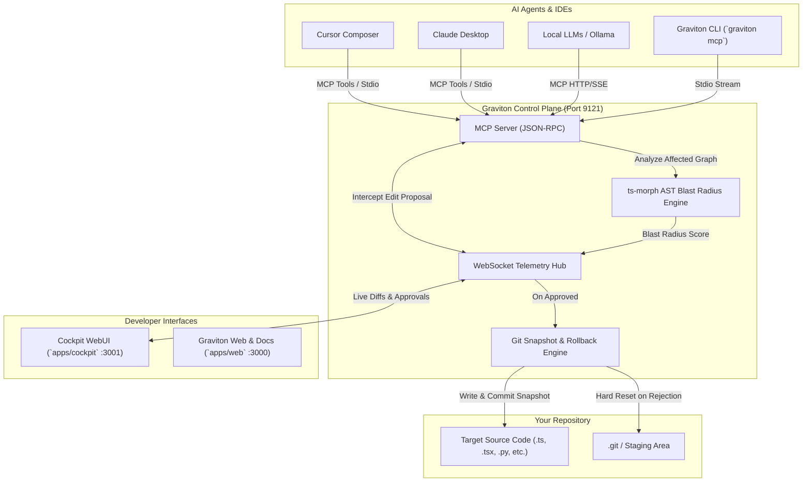

# 🪐 GRAVITON

<p align="center">
  <strong>Your code is the center. AI orbits it. You control the gravity.</strong>
</p>

<p align="center">
  <a href="https://www.npmjs.com/package/@yakkshit/graviton"></a>
  <a href="https://bun.sh"></a>
  <a href="https://nextjs.org"></a>
  <a href="https://tailwindcss.com"></a>
  <a href="https://modelcontextprotocol.io"></a>
  <a href="https://turbo.build"></a>
  <a href="./LICENSE"></a>
</p>

---

## ⚡ What is Graviton?

**Graviton** (`@yakkshit/graviton`) is a self-hosted, multi-model AI coding cockpit and Zero-Trust Model Context Protocol (MCP) control plane. 

Modern reasoning models (Claude 3.7 Sonnet, Gemini 2.5 Flash, GPT-4o, DeepSeek R1, Local Ollama) generate code with incredible velocity. However, giving AI direct write access to your file system is risky—leading to regressions, hidden side effects, and broken production branches.

Graviton places a **human-in-the-loop interceptor** between your AI models and your filesystem:
- **Zero Direct Writes:** When an AI tool calls `propose_edit`, the edit is trapped in memory.
- **AST Blast Radius Calculation:** Graviton parses downstream dependencies via `ts-morph` AST analysis in real-time, warning you if a change impacts 1 file or 40 with animated counter feedback.
- **Interactive Cockpit WebUI:** You inspect unified/split diffs, examine affected symbols, and click **Approve**, **Block**, or **Rollback**.
- **Global Command Palette (⌘K):** Raycast-style spotlight search to jump to pending diffs, toggle live theme accents, or manage remote pairing sessions.
- **Premium Toast Feedback:** Powered by 21st.dev Sonner notifications for model proposals, commit approvals, and instant state rollbacks.
- **Git-Native Snapshot Isolation:** Every approved edit creates a deterministic checkpoint; rejections safely reset the staging tree without manual cleanup.

---

## 🏗️ Architecture



---

## 📂 Monorepo Structure

Graviton is organized as a high-performance **Turborepo** monorepo powered strictly by **`bun`**:

```text
graviton/
├── apps/
│   ├── cockpit/         # Next.js 16 Cockpit Dashboard (Port 3001)
│   │   ├── app/page.tsx # Tri-column desktop layout (Tree, DiffViewer, ActionPanel)
│   │   ├── components/  # TopBar, FileTree, DiffViewer, ActionPanel
│   │   └── lib/         # Zustand state store & WebSocket client
│   ├── server/          # Core MCP & WebSocket Engine (Port 9121)
│   │   ├── lib/ast-analyzer.ts # ts-morph dependency impact calculator
│   │   ├── lib/engine.ts       # simple-git snapshot & safe path execution
│   │   ├── lib/ws-server.ts    # Broadcasts diff proposals & awaits decisions
│   │   └── lib/mcp-server.ts   # Zero-trust MCP tools implementation
│   └── web/             # Award-winning Next.js 16 Marketing Site (Port 3000)
│       ├── components/  # Hero, GravityLoop, FeatureBento, Architecture, Footer
│       └── app/         # Tailwind CSS v4 + 21st.dev Dynamic Theme Engine
├── packages/
│   ├── cli/             # Global CLI `@yakkshit/graviton` (bin: `graviton`)
│   │   └── src/index.ts # `graviton start` & `graviton mcp` commands
│   ├── ui/              # Shared 21st.dev components (Toasts, Cmd+K, Shimmer, AnimatedNumber)
│   ├── eslint-config/   # Shared ESLint rules
│   └── typescript-config/# Shared strict tsconfig files
├── turbo.json           # Turborepo task pipeline
└── package.json         # Workspace root configuration
```

---

## 🚀 Quick Start

### 1. Prerequisites
- **[Bun](https://bun.sh)** `v1.2.0` or higher:
  ```bash
  curl -fsSL https://bun.sh/install | bash
  ```

### 2. Run Directly with Bunx (Zero Install)
```bash
bunx @yakkshit/graviton@latest
```

### 3. Local Development
```bash
git clone https://github.com/context-code/graviton.git
cd graviton
bun install
bun run build
bun run dev
```

- 🌐 **Marketing Site:** `http://localhost:3000`
- 🎛️ **Cockpit Dashboard:** `http://localhost:3001`
- 🔌 **Graviton Telemetry & MCP Engine:** `ws://localhost:9121`

---

## 🛠️ Global CLI (`graviton`)

Graviton is published on npm as [`@yakkshit/graviton`](https://www.npmjs.com/package/@yakkshit/graviton).

### Start the Cockpit & Engine
```bash
# Launch Cockpit and MCP daemon on current repository
graviton start

# Or with custom port and automated public tunnel
graviton start --port 9121 --tunnel
```

Options:
- `-p, --port <number>`: Telemetry WebSocket port (default: `9121`)
- `-d, --dir <path>`: Target repository directory (default: `.`)
- `-a, --auth-key <string>`: Secret authentication token required for WS/MCP connections (auto-generates UUID if omitted)
- `-t, --tunnel`: Automatically spin up a secure public HTTPS/WSS tunnel via `localtunnel`
- `--no-open`: Skip automatic browser launch of the Cockpit WebUI

---

## 🔌 Connecting to AI Agents (Cursor & Claude)

Graviton provides native Model Context Protocol (MCP) capabilities. Configure your tools to route edits through Graviton's zero-trust gateway:

### Claude Desktop Configuration
Add Graviton to your `claude_desktop_config.json`:
- **macOS:** `~/Library/Application Support/Claude/claude_desktop_config.json`
- **Windows:** `%APPDATA%\Claude\claude_desktop_config.json`

```json
{
  "mcpServers": {
    "graviton": {
      "command": "bunx",
      "args": ["@yakkshit/graviton", "mcp"],
      "cwd": "/absolute/path/to/your/project"
    }
  }
}
```

### Cursor Composer Configuration
Add Graviton to your workspace's `.cursor/mcp.json`:

```json
{
  "mcpServers": {
    "graviton": {
      "command": "bunx",
      "args": ["@yakkshit/graviton", "mcp"]
    }
  }
}
```

---

## 🎛️ Key Capabilities

| Feature | Description |
| :--- | :--- |
| **Zero-Trust Intercepts** | AI proposals are held in staging until developer approval. No surprise disk writes. |
| **AST Blast Radius & Animated Counters** | `ts-morph` traverses symbol imports across the project, returning exact file impact counts and dynamic risk levels (`LOW`, `MODERATE`, `HIGH`, `CRITICAL`) animated in real-time. |
| **Command Palette (⌘K)** | Global spotlight search with fuzzy filtering to jump to diffs, switch theme accents, and toggle session settings. |
| **Shimmer & Skeleton Loaders** | High-fidelity shimmer loaders while WebSocket is connecting or diffs are rendering. |
| **Sonner Toast System** | Animated notifications for diff proposals, approvals, rollbacks, and error reporting. |
| **Secure Remote Tunneling** | Integrated `localtunnel` with token-based authentication (`--tunnel`, `--auth-key`) for cloud agents and pairing. |
| **Git Snapshot Commits** | Automatically commits state snapshots before edits so you can roll back instantly with zero manual Git surgery. |
| **Dynamic Theme Engine** | Switch the cockpit accent color live (Electric Blue `#3B82F6`, Terminal Green `#10B981`, Neon Purple `#A855F7`, Cyber Yellow `#EAB308`, Crimson `#EF4444`). |

---

## 📜 License

Distributed under the **MIT License**. See [`LICENSE`](./LICENSE) for more information.

<p align="center">
  <sub>Built with ❤️ by the Graviton Team</sub>
</p>
