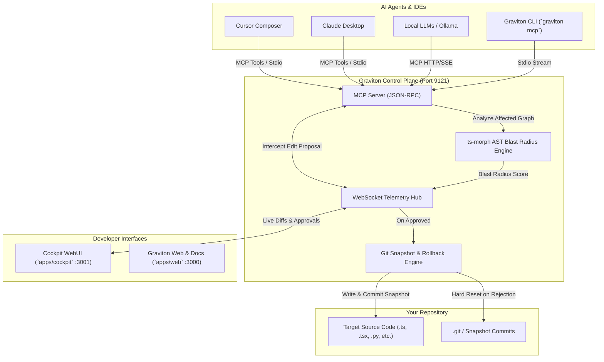

<p align="center">
  <h1 align="center">🪐 GRAVITON</h1>
  <p align="center">
    <strong>Your code is the center. AI orbits it. You control the gravity.</strong>
  </p>
  <p align="center">
    The self-hosted, zero-trust AI coding cockpit and Model Context Protocol (MCP) control plane.
  </p>
</p>

<p align="center">
  <a href="https://www.npmjs.com/package/@yakkshit/graviton"></a>
  <a href="https://pypi.org/project/graviton-cli"></a>
  <a href="./LICENSE"></a>
  <a href="https://github.com/yakkshit/graviton"></a>
  <a href="https://bun.sh"></a>
  <a href="https://modelcontextprotocol.io"></a>
  <a href="https://turbo.build"></a>
</p>

---

## ⚡ What is Graviton?

Modern reasoning models (Claude 3.7 Sonnet, Gemini 2.5 Flash, GPT-4o, DeepSeek-R1, Local Ollama) write code at blinding speeds. But giving autonomous agents direct, unmonitored write access to your filesystem invites catastrophic regression, context blindness, and broken production branches.

**Graviton** places a **Zero-Trust Control Plane** between your AI models and your disk:
1. **Traps Proposals in Memory:** Every tool edit is caught in an isolated in-memory buffer before hitting disk.
2. **Computes Blast Radius:** Recursively parses downstream AST dependencies with `ts-morph` to gauge project-wide impact.
3. **Presents Cockpit WebUI:** You inspect unified/split diffs, check affected symbols, and click **Approve**, **Block**, or **Rollback**.
4. **Guarantees Git Determinism:** Auto-commits safety snapshots before writes, enabling single-click rollback without manual Git surgery.

---

## ✨ Features

- 🛡️ **Zero-Trust Edits:** Intercepts `propose_edit` in-memory. Zero unvetted disk writes by reasoning models or autonomous agents.
- 💥 **AST Blast Radius:** Powered by `ts-morph` AST dependency scanning. Calculates the downstream ripple effect across your codebase, giving you exact affected file counts and real-time risk tiers (`LOW`, `MODERATE`, `HIGH`, `CRITICAL`).
- ↩️ **Git-Native Rollbacks & Snapshots:** Every approved change creates an atomic git snapshot. One-click instant rollback reverts files cleanly without manual git surgery or broken working trees.
- 🤖 **Multi-Model MCP:** Universal control plane connecting Claude 3.7 Sonnet, Gemini 2.5 Flash, GPT-4o, DeepSeek R1, and local Ollama instances over stdio or secure WebSocket/HTTP tunnels.
- 🔍 **Command Palette (`⌘K`):** Raycast-style spotlight search with instant fuzzy filtering to jump to pending diffs, toggle live theme accents, or manage remote pairing sessions.
- 🔔 **Sonner Toast System:** Fluid, animated feedback for incoming model proposals, human approvals, and instant rollbacks.
- 🎨 **Dynamic Theme Engine:** Switch live cockpit accent frequencies (Electric Blue, Terminal Green, Neon Purple, Cyber Yellow, Crimson) with variable CSS injection (`var(--color-accent)`).

---

## 🚀 Quick Start

### Option A: Bunx / NPX (Zero install required)

```bash
# Using Bun (instant startup)
bunx @yakkshit/graviton start

# Or using NPX
npx @yakkshit/graviton start
```

### Option B: Python (via PyPI)

```bash
# Install globally or in your virtualenv
pip install graviton-cli

# Run anywhere
graviton start
```

### CLI Command Options

```bash
# Launch Cockpit WebUI and local MCP daemon on target repository
graviton start --dir . --port 9121

# Spin up an end-to-end encrypted public tunnel for remote pairing:
graviton start --tunnel

# Provide a specific authentication token:
graviton start --tunnel --auth-key "your-secure-secret-token"
```

| Option | Flag | Default | Description |
| :--- | :--- | :--- | :--- |
| **Port** | `-p, --port <number>` | `9121` | WebSocket & HTTP telemetry server port |
| **Target Directory** | `-d, --dir <path>` | `.` | Root directory of the repository to supervise |
| **Auth Key** | `-a, --auth-key <string>` | *(Auto-generated UUID)* | Secret token required for WS/MCP connections |
| **Public Tunnel** | `-t, --tunnel` | `false` | Automatically provisions secure public HTTPS/WSS URL |
| **No Open** | `--no-open` | `false` | Prevent auto-opening default browser to Cockpit WebUI |

---

## 🔌 IDE Setup (Cursor & Claude Desktop)

Graviton exposes native Model Context Protocol (MCP) tools (`read_file`, `propose_edit`, `get_ast_graph`, `rollback_checkpoint`). 

Add Graviton to your editor configuration to enforce zero-trust reviews:

### 1. Cursor Composer (`.cursor/mcp.json`)
Place this in your workspace's `.cursor/mcp.json` (or global Cursor configuration):

```json
{
  "mcpServers": {
    "graviton": {
      "command": "bunx",
      "args": ["@yakkshit/graviton", "mcp"],
      "cwd": "${workspaceFolder}"
    }
  }
}
```

### 2. Claude Desktop (`claude_desktop_config.json`)
Edit your Claude Desktop configuration file:
- **macOS:** `~/Library/Application Support/Claude/claude_desktop_config.json`
- **Windows:** `%APPDATA%\Claude\claude_desktop_config.json`

```json
{
  "mcpServers": {
    "graviton": {
      "command": "bunx",
      "args": ["@yakkshit/graviton", "mcp"],
      "cwd": "/absolute/path/to/your/project"
    }
  }
}
```

*When Claude or Cursor initiates a file edit, Graviton immediately catches the proposal, calculates the AST blast radius, and streams the diff to your Cockpit WebUI for review!*

---

## 🏗️ Architecture



---

## 📂 Monorepo Structure

Graviton is architected as an ultra-fast **Turborepo** monorepo powered strictly by **`bun`**:

```text
graviton/
├── apps/
│   ├── cockpit/         # Next.js 16 Cockpit Dashboard (Port 3001)
│   │   ├── app/page.tsx # Tri-column desktop layout (Tree, DiffViewer, ActionPanel)
│   │   ├── components/  # TopBar, FileTree, DiffViewer, ActionPanel, ThemeCustomizer
│   │   └── lib/         # Zustand store, socket-client, AST impact mapping
│   ├── server/          # Core MCP & WebSocket Engine (Port 9121)
│   │   ├── lib/ast-analyzer.ts # ts-morph dependency impact calculator
│   │   ├── lib/engine.ts       # simple-git snapshot & safe path execution
│   │   ├── lib/ws-server.ts    # Broadcasts diff proposals & awaits decisions
│   │   └── lib/mcp-server.ts   # Zero-trust MCP tools implementation
│   └── web/             # Next.js 16 Marketing Site (Port 3000)
│       ├── components/  # Hero, GravityLoop, FeatureBento, Architecture, Footer
│       └── app/         # Tailwind CSS v4 + 21st.dev Dynamic Theme Engine
├── packages/
│   ├── cli/             # Global CLI `@yakkshit/graviton` (bin: `graviton`)
│   │   └── src/index.ts # `graviton start` & `graviton mcp` commands
│   ├── ui/              # Shared 21st.dev components (Toasts, Cmd+K, Shimmer, AnimatedNumber)
│   ├── eslint-config/   # Shared ESLint rules
│   └── typescript-config/# Shared strict tsconfig files
├── turbo.json           # Turborepo task pipeline
└── package.json         # Workspace root configuration
```

---

## 🛠️ Local Development

```bash
# 1. Clone repository
git clone https://github.com/yakkshit/graviton.git
cd graviton

# 2. Install dependencies
bun install

# 3. Build monorepo packages
bun run build

# 4. Launch all dev services in parallel
bun run dev
```

- 🌐 **Marketing Web:** `http://localhost:3000`
- 🎛️ **Cockpit Dashboard:** `http://localhost:3001`
- 🔌 **Graviton Telemetry & Engine:** `ws://localhost:9121`

---

## 📜 License

Distributed under the **MIT License**. See [`LICENSE`](./LICENSE) for more information.

<p align="center">
  <sub>Built with ❤️ by the Graviton Team</sub>
</p>
